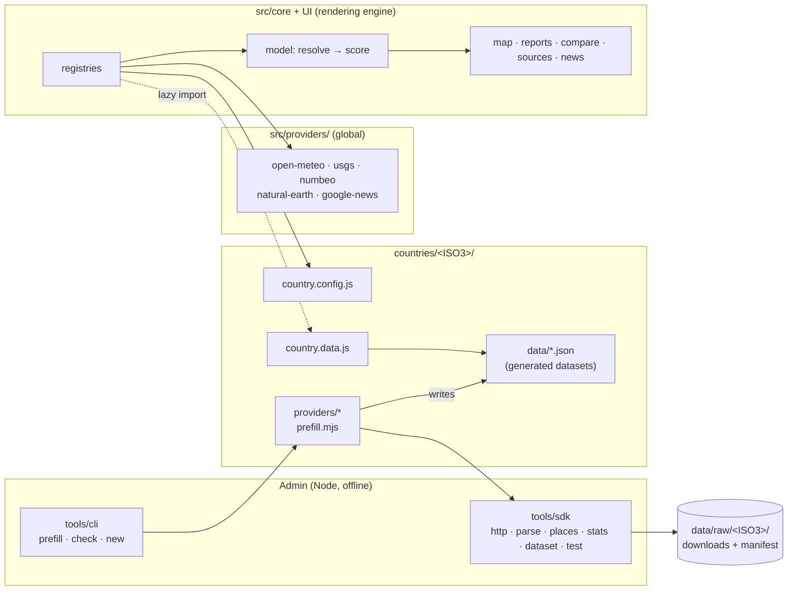

# MapStats architecture

This document defines how MapStats is structured so that each country can be integrated by its own developers, in its own folder, without touching the rendering engine.

- **Audience:** the core team, and developers who will own a country.
- **Status:** target design. The [migration plan](#8-migration-plan) moves the current code to it step by step, and the app keeps working after each step.
- **Related:** [Country integration guide](country-guide.md) · [Dataset schema](schemas/dataset.schema.json) · [Country template](samples/country-template/)

---

## 1. Goals

1. **Country work stays in the country folder.** A country developer works only in `countries/<ISO3>/`. They never need to edit the core to add a data source, a city list, news outlets or a yearly import.
2. **The core renders any country.** The map, scoring, reports, compare view, sources view and news are generic. They only read data that follows the contracts in [section 4](#4-contracts).
3. **Scores stay comparable across countries.** Indicators are defined once, globally, with fixed definitions and domains. Countries supply values for them. They do not redefine them.
4. **Every number can be traced.** Each value records its provider, the geographic level it was measured at, its period and the files it came from.
5. **The best available source wins, and the choice is explicit.** Reliability is derived from what kind of source a provider is, how close its geography is to the place, and how recent its data is. The rules are the same for every country.
6. **Long-term data is prepared offline.** Yearly and other slow-moving statistics are produced by a prefill pipeline and shipped as files. The browser only calls free, keyless, CORS-enabled APIs.

## 2. Where we are today

The app's features are the ones we want. The problem is the data layer, which assumes Argentina:

| Coupling | Where |
|---|---|
| `iso3 === 'ARG'` branches and direct imports of Argentine data | `src/lib/scoring.js` (`baseCities`, `buildEntities`, `adHocEntity`) |
| Indicators tied to Argentine sources (`source: 'SNIC'`, `'EPH'`, `'Censo 2022'`) and domains calibrated on Argentina (`lifeExp: [74, 79]`, `hdi: [0.75, 0.9]`) | `src/data/metrics.js` |
| Global and Argentine sources in one registry; families hardcoded (`snic`, `numbeo`, `provincial`) | `src/data/sources.js` (`SOURCES`, `SOURCE_META`, `familyOf`) |
| Reliability rules written for specific sources | `src/lib/sourceWeights.js` |
| Report sections, compare measures and search tags written for SNIC and Numbeo | `ReportPanel.jsx`, `compare/measures.js`, `SearchBox.jsx`, `SourcesView.jsx`, `lib/provenance.js` |
| Country list repeated in three places | `src/data/countries.js` (`COUNTRIES` and `NEWS`), `scripts/build-geo.mjs` |
| News: ambiguous names and outlets only for Argentina | `src/lib/news.js` (`AMBIGUOUS`, `GN_HL`), `netlify/news/outlets.mjs` (`outletsFor` returns `[]` outside ARG) |
| Import scripts that only work for one country | `scripts/snic-import.mjs`, `scripts/numbeo-*.mjs` |
| All curated data in the main bundle (`snic-argentina.json` is 425 KB), whichever country is shown | `src/data/argentina.js` |

The rest is already generic and stays: MapLibre rendering, the Open-Meteo request queue and cache (`meteoQueue.js`, `live.js`), USGS, geocoding, colour scales, exports, and the news pipeline in `netlify/news/`.

## 3. Structure

The [base structure](base-structure.md) splits MapStats into **Countries** (data providers for stats and news), the **Rendering engine** and **Admin** (the yearly prefill). In the code, that becomes four areas with one-way dependencies:



Dependencies only go one way:

- `src/core` never imports from `countries/`. It discovers countries through the registry.
- A country may import from `src/core/define.js`, the SDK and global providers. It never imports from another country.
- Browser code never imports `tools/` or a `*.mjs` prefill script.

### 3.1 Folder layout

```
src/
  core/                       rendering engine, country-agnostic
    define.js                 defineCountry / defineProvider: validation + defaults (browser-safe)
    indicators.js             global indicator catalogue, topics, scoring categories
    countries.js              country registry (manifests) + lazy data loader
    providers.js              provider registry, reliability rules
    model/
      resolve.js              datasets + live data → values per place, with provenance
      score.js                normalisation, categories, combined / weighted modes (today's scoring.js)
    live/                     request queue, cache, batch runner (today's meteoQueue.js, live.js)
  providers/                  global providers, available to every country
    open-meteo/  usgs/  natural-earth/  google-news/  numbeo/
  components/  hooks/  lib/   UI. Reads the model only, never a specific provider.

countries/
  index.js                    one line per country (manifests only; small and pure)
  _template/                  copied by `npm run country:new`
  ARG/
    country.config.js         manifest: identity, geo settings, providers, news, maintainers
    country.data.js           browser entry: places + datasets + optional report sections (lazy chunk)
    places.js                 curated cities and code crosswalks (optional)
    news.js                   news language, edition, ambiguous names, outlets
    providers/
      snic/                   provider.js · prefill.mjs · parse.mjs · fixtures/ · provider.test.mjs · README.md
      provincial-stats/
    data/                     generated datasets (committed): snic.json, provincial-stats.json …
    geo/                      generated boundaries + Natural Earth cities (regions.json, cities.json)
    README.md                 status, sources, coverage, known gaps
  BOL/
    country.config.js         environment-only country: manifest + geo only
    …

tools/
  sdk/                        Node toolkit for country developers (section 6)
  cli/                        prefill · country:new · country:check · geo:build

data/raw/<ISO3>/<provider>/   downloaded source files (gitignored) + manifest.json (committed)
netlify/                      functions; the news function reads country news config from countries/index.js
docs/
```

Path aliases (the `imports` field in `package.json`, which Node, Vite and esbuild all resolve) keep imports independent of folder depth:

```json
"imports": {
  "#core/*": "./src/core/*",
  "#providers/*": "./src/providers/*",
  "#sdk": "./tools/sdk/index.mjs",
  "#sdk/*": "./tools/sdk/*"
}
```

### 3.2 Why two files per country (`config` and `data`)

| File | Contents | Imported by | Size |
|---|---|---|---|
| `country.config.js` | Pure metadata: names, bounds, labels, provider ids, news settings | the app (country picker), the news function, scripts | A few KB, every country |
| `country.data.js` | Places, dataset JSON, report extensions | the app only, through `import()` when the country is selected | Can be large; only loaded on demand |

`countries/index.js` imports only the configs. The Netlify function stays small, and Vite builds one chunk per country, so Argentina's 425 KB of SNIC data is no longer loaded for Bolivia. Geo files are referenced with `?url` imports, so Vite emits them with content hashes and they can be cached long-term.

## 4. Contracts

These are the interfaces between a country and the core. They are written as JSDoc typedefs in `src/core/define.js` (with `// @ts-check` in country files for editor checking). Datasets also have a JSON Schema, which `country:check` validates.

### 4.1 Indicator (core-owned)

An indicator defines **what** is measured. It does not say who measures it.

```js
{
  id: 'homicide',
  label: 'Homicide rate',
  unit: '/100k',
  topic: 'crime',                 // browsing taxonomy (below)
  category: 'safety',             // scoring bucket with a user weight
  better: 'low',                  // 'high' | 'low' | null (null = descriptive, never scored)
  domain: [0, 8],                 // fixed normalisation range, used only to compute scores (rule below)
  digits: 1,
  definition: 'Victims of intentional homicide per 100,000 inhabitants, mean of the latest 3 years (UNODC ICCS 0101).',
}
```

**Topics** follow the base structure, and tell a country developer where their data fits:

| Topic | Scoring category | Example indicators |
|---|---|---|
| `crime` | safety | homicide, propertyCrime, crimeIndex |
| `roadSafety` | safety | roadDeaths |
| `weather` | environment / descriptive | climateComfort, meanTemp, annualPrecip, uvMean |
| `air` | environment | aqi, pollutionIndex |
| `naturalDisasters` | hazards | quakes, seismicZone, fireRisk, floodRisk, floodWatch |
| `geography` | descriptive | elevation |
| `population` | descriptive | pop |
| `services.health` | services | doctors, healthcareIndex |
| `services.water` | services | water, sewer |
| `services.electricity` | services | electricity *(new)* |
| `services.internet` | services | internet |
| `infrastructure` | infrastructure | roadPaved, transit, trafficIndex |
| `costOfLiving` | economy | costOfLiving, purchasingPower |
| `economy` | economy | poverty, unemployment, lifeExp, hdi |

Rules:

- New scored indicators are added to the core catalogue by pull request, reviewed by the core team. The `definition` must be precise enough that two countries' statistics offices produce comparable numbers.
- A country may declare **descriptive** extras (`better: null`) in its config. They show in reports but never affect scores.
- **The domain is only for scores.** It maps an indicator to 0–100 so different units can be averaged into category scores and the MapStats score. Everything that renders or compares an indicator uses its **real values**: map colours, legends, meters (positioned between the country's lowest and highest value, `model.ranges`), the "best" mark in compare, charts and exports. Report and compare components never import `normalise`.
- **Domains are global.** They are set from the spread across all supported countries, not from one country. The current Argentine calibration must be revisited before a second country is curated (see [open decisions](#9-open-decisions)).

### 4.2 Provider

A provider is one data source. **Global providers** (`src/providers/<id>/`) serve every country: Open-Meteo, USGS, Natural Earth, Google News and Numbeo. **Country providers** (`countries/<ISO3>/providers/<id>/`) are local: SNIC, a national census, a statistics office. Their ids are namespaced automatically as `ARG/snic`.

```js
// countries/ARG/providers/snic/provider.js — browser-safe metadata
export default defineProvider({
  id: 'snic',
  name: 'SNIC – Ministerio de Seguridad',
  url: 'https://www.argentina.gob.ar/seguridad/estadisticascriminales/bases-de-datos',
  license: '…',                  // exact licence or terms URL, checked before importing
  kind: 'register',              // drives base reliability (table below)
  access: 'dataset',             // 'live' | 'dataset' | 'manual'
  cadence: { every: 'year', expected: 'June' },
  topics: ['crime', 'roadSafety'],
  provides: {
    homicide:      { levels: ['region', 'subregion'] },
    propertyCrime: { levels: ['region', 'subregion'] },
    roadDeaths:    { levels: ['region', 'subregion'] },
  },
  family: 'official-crime',       // groups providers in the single-source selector (optional, defaults to id)
  // Optional extra reliability factors, on top of the generic ones:
  weightFactors: (ctx) => [],
})
```

**Base reliability by kind** (generalises today's `BASE` in `sourceWeights.js`):

| `kind` | Weight | Meaning | Today |
|---|---|---|---|
| `register` | 1.0 | Official count of recorded cases | SNIC |
| `measurement` | 1.0 | Instrument or reanalysis | Open-Meteo, USGS |
| `official-survey` | 0.8 | Statistics office sample survey with published methodology | *(new: EPH, if imported rather than typed)* |
| `crowd-survey` | 0.5 | Perception survey, self-selected respondents | Numbeo |
| `estimate` | 0.3 | Modelled or derived by MapStats or a third party | |
| `manual` | 0.3 | Hand-entered from a publication | today's provincial figures |

**Generic factors**, applied in the core to every provider so countries do not reimplement them:

| Factor | Multiplier |
|---|---|
| Value measured for the place itself (`city`) | 1.0 |
| Measured for its `subregion` (department, municipality, county) | 0.9 |
| Measured for its `region` and used for a city | 0.5 |
| Recency: full weight within a year of the period, then −15 % per year | down to 0.5 |
| Dataset-declared quality (`quality.respondents`, `quality.snapshot`) | provider-defined |

### 4.3 Places and levels

| Level | What it is | Id | Comes from |
|---|---|---|---|
| `national` | The country | `ISO3` | config |
| `region` | First-level division (province, state, department) | ISO 3166-2, e.g. `AR-B` | `geo/regions.json` (Natural Earth) |
| `subregion` | Second level (partido, municipality, county), optional | the national statistical code, e.g. `06441` | provider data; no polygons required |
| `city` | Point place | `ISO3-slug`, e.g. `ARG-la-plata` | `places.js`, or the Natural Earth city list |

A curated city carries a `codes` map that links it to each provider's identifiers. This generalises today's `SNIC_DEPT` table and `numbeoSlug` field:

```js
{ id: 'ARG-la-plata', name: 'La Plata', region: 'AR-B', lat: -34.92, lon: -57.95, pop: 772618,
  codes: { subregion: '06441', numbeo: 'La-Plata' } }
```

### 4.4 Dataset (output of a prefill, input of the app)

One JSON file per provider and country, in `countries/<ISO3>/data/<provider>.json`. Schema: [`docs/schemas/dataset.schema.json`](schemas/dataset.schema.json). Example: [`samples/country-template/data/example-stats.json`](samples/country-template/data/example-stats.json).

```jsonc
{
  "schema": 1,
  "provider": "ARG/snic",
  "country": "ARG",
  "generatedAt": "2026-06-20T10:00:00Z",
  "period": { "latest": 2025, "aggregation": "mean of 2023–2025" },
  "origin": { "files": [{ "name": "snic-departamentos.csv", "url": "https://…", "sha256": "…", "retrievedAt": "2026-06-19" }] },
  "values": {                        // level → place id → indicator id → number | null
    "national":  { "ARG":   { "homicide": 4.1 } },
    "region":    { "AR-B":  { "homicide": 4.5, "propertyCrime": 3100 } },
    "subregion": { "06441": { "homicide": 5.2 } },
    "city":      {}
  },
  "names": { "subregion": { "06441": "La Plata" } },
  "series": {                        // optional: drives the generic "Trends" report section and compare charts
    "years": [2016, 2017, 2018],
    "region": { "AR-B": { "homicide": [5.0, 4.8, 4.6] } }
  },
  "details": {}                      // optional, provider-specific detail for "values by source" (counts, survey answers…)
}
```

Rules:

- **Missing stays missing.** Use `null` or leave the indicator out. Never fill a value from a neighbouring area or an estimate inside a dataset. The core decides what to borrow and labels it.
- Values use the **indicator's unit** (`homicide` per 100k, `water` as a %). Conversions happen in the prefill, not in the app.
- Every id must exist: region ids in `geo/regions.json`, city ids in `places.js`, indicator ids in the catalogue. `country:check` enforces this.

### 4.5 Live providers

A live provider runs in the browser. It is allowed only if it is **free, keyless, CORS-enabled and rate-limit-safe**. It implements:

```js
export default {
  ...meta,                                  // defineProvider(...) with access: 'live'
  fetchBatch(points, { signal, priority, onProgress }) { /* → { data: { [pointId]: { [indicator]: value } }, loaded, failed } */ },
  fetchDetail(lat, lon, { signal }) { /* optional: per-place data for the report */ },
}
```

It must go through the shared queue and cache in `src/core/live/`. Those enforce Open-Meteo's budget and keep the cache in `localStorage`. A source that needs a key, a proxy or scraping is **not** a live provider: it becomes a prefill dataset, or (with core-team review) a Netlify function like `/api/news`.

### 4.6 Report extensions

Report sections are generated from the data first:

| Data in the dataset | Generated UI |
|---|---|
| `values` | Indicator rows, "values by source", scores and compare rows |
| `series` | A "Trends" section with this place, its region and the country, plus compare line charts. This replaces the hardcoded SNIC charts. |
| `details.survey` with labelled questions | A "Survey answers" section and a compare bar chart. This replaces the hardcoded Numbeo survey. |

A country can add a custom section only when the generic ones cannot show its data:

```js
// country.data.js
report: [{ id: 'ARG-snic-detail', topic: 'crime', title: 'SNIC detail', component: SnicDetail }]
// component props: { entity, model, theme }, the same contract as the built-in sections
```

### 4.7 News

`countries/<ISO3>/news.js` is pure data, imported by both the app and the `/api/news` function:

```js
export default {
  lang: 'es',
  countryName: 'Argentina',              // as local outlets write it
  edition: { hl: 'es-419', gl: 'AR' },   // Google News edition
  keywords: { add: ['motochorro'] },     // extends the core list for `lang`
  ambiguousNames: ['merlo', 'junin', 'concepcion', 'san martin'],
  outlets: {
    verified:   [{ domain: 'eldia.com', feed: 'https://www.eldia.com/feed', regions: ['buenos aires'], cities: ['la plata'] }],
    candidates: [{ domain: 'elonce.com', regions: ['entre rios'], note: 'no feed found' }],
  },
}
```

The pipeline (`netlify/news/`) stays generic. `outletsFor` reads the country's list instead of returning `[]` outside Argentina. News is never used in scores.

## 5. Runtime data flow

```
select country
  └─ registry: config (sync) + import('country.data.js') (lazy) + geo (fetch)
       └─ places = curated places ?? Natural Earth cities
            └─ live providers fill points progressively (queue + cache)
                 └─ resolve(datasets, live, places)
                      for each place × indicator × provider: take the value at the closest level
                      (city → subregion → region), record { value, provider, level, period, borrowed }
                      └─ score(values, weights, mode)  ← unchanged maths: fixed domains, median / weighted
                           └─ map · ranking · reports · compare · exports
```

The resolver is the one place that decides how a value reaches a place. It replaces today's mix of `PROVINCES` spreads, `ownValues`, `inherited` sets and `numbeoBaseline`. Every entity then carries the same provenance shape (`entity.sources[indicatorId] = [{ provider, level, value, period, borrowed }]`), whatever its country. The UI reads that instead of `entity.snic` or `entity.numbeo`.

## 6. The country developer toolkit (`tools/sdk`)

The toolkit gives country developers the shared services they need to get good data from good sources without rewriting plumbing. It runs in Node only, at prefill time.

| Module | Provides | Built from |
|---|---|---|
| `http` | `rawStore(country, provider)`: `fetchOnce(url)` downloads each file once into `data/raw/`, records URL, date and sha256 in `manifest.json`, honours robots.txt, sends an honest User-Agent, waits between requests (5 s by default) and stops at the first 403/429. `--refresh` is refused inside the provider's cadence. | `scripts/numbeo/store.mjs`, `netlify/news/robots.mjs` |
| `parse` | `parseCsv` (delimiter and encoding detection), `readXlsx` (exceljs), `loadHtml` (cheerio), `parseFeed` (RSS/Atom) | `scripts/snic-import.mjs`, `netlify/news/rss.mjs` |
| `places` | `fold()` accent-insensitive names; `matcher(country)` with `region(name)`, `city(name, region)` and aliases; `pointToRegion(lat, lon)`; an unmatched-names report | `src/lib/geo.js`, `lib/news.js` |
| `stats` | `per100k(count, pop)`, `meanOfLast(series, n)`, `round`, `share(part, total)` | |
| `dataset` | `writeDataset()`: fills the header, validates against the schema and catalogue, writes JSON, prints a coverage table | |
| `test` | `check(label, ok)`, `fixture(url)`, `done()`: the runner style of `news:test` and `live:test` | `netlify/news/test/run.mjs` |

**CLI** (`tools/cli`, run with `npm run`):

| Command | Does |
|---|---|
| `country:new -- XXX` | Copies `countries/_template`, fills iso codes and names, adds the line to `countries/index.js`, builds geo |
| `geo:build -- XXX` | Natural Earth → `countries/XXX/geo/` using the config's `geo` settings (today's `build-geo.mjs`, made per-country) |
| `prefill -- XXX [--provider id] [--offline]` | Runs each dataset provider's `prefill()`, then validates and writes `data/<id>.json`. `--offline` re-parses files already in `data/raw` without downloading. |
| `prefill:due` | Lists datasets whose cadence has elapsed since `generatedAt` (the yearly calendar) |
| `country:check -- XXX` | Validates config, ids and datasets, flags values far outside indicator domains, runs provider tests, prints coverage and the country's tier |
| `test` | All offline tests: core, news, live, every provider's `provider.test.mjs` |

## 7. Admin: the prefill process

Long-term data (crime registers, census, surveys, infrastructure) changes yearly or less often. It is prepared offline, reviewed as a pull request and shipped as files. It is never fetched by visitors.

```
acquire  → data/raw/XXX/<provider>/ + manifest.json (url, retrievedAt, sha256)   fetched once, politely
parse    → rows                                                                  pure function, fixture-tested
map      → place ids (crosswalk / matcher), indicator ids, indicator units        unmatched names reported, never guessed
validate → schema · ids · domains · coverage                                     fails the run on errors
write    → countries/XXX/data/<provider>.json + coverage summary                 committed and reviewed in a PR
```

**Yearly calendar.** Each provider declares `cadence`. A scheduled GitHub Action runs `npm run prefill:due` monthly and opens one issue per stale dataset, assigned to the country's maintainers. There is no admin web UI: the app stays static, and the pull request is the review step.

**Raw files** are not committed: licences vary and the files are large. `manifest.json` is committed, so anyone can download the same files and check them against the recorded hashes.

## 8. Migration plan

Each step ships separately and keeps the app working. Steps 1–5 must not change any score. A **golden test** guards this: it saves today's `buildEntities` output for Argentina (scores, ranks and values for each mode) and compares the new pipeline against it.

| # | Step | Moves | Size |
|---|---|---|---|
| 0 | Golden test + `npm test` aggregator + CI (lint, tests, build on every PR) | — | S |
| 1 | **Country registry.** `countries/<ISO3>/country.config.js` for all 16, `countries/index.js`, `#core`/`#sdk` aliases. `src/data/countries.js` re-exports the registry. `build-geo` reads the configs and writes to each country's `geo/`. | `countries.js` (`COUNTRIES`, `NEWS`), `build-geo.mjs` list | M |
| 2 | **Provider registry.** Split `SOURCES`/`SOURCE_META` into provider definitions: global ones in `src/providers/`, Argentine ones in `countries/ARG/providers/`. `familyOf` uses `provider.family`. `sourceWeight` uses kind + generic factors + `weightFactors`. Remove `source` from indicators. | `sources.js`, `sourceWeights.js`, `metrics.js` | M |
| 3 | **Datasets + resolver.** A one-off converter writes `countries/ARG/data/{snic,numbeo,provincial-stats}.json` from today's files. `places.js` replaces `argentina.js` cities, with `codes`. `resolve.js` replaces the ARG branches in `scoring.js`. Country data loads lazily. | `argentina.js`, `snic-argentina.json`, `numbeo-*.json`, `scoring.js` | L |
| 4 | **Generic report and compare sections** (trends from `series`, survey from `details`), provenance from `entity.sources`, source tags in search from the provider registry | `ReportPanel.jsx`, `compare/measures.js`, `provenance.js`, `SearchBox.jsx`, `SourcesView.jsx` | M |
| 5 | **News per country.** `countries/ARG/news.js` takes the outlets and ambiguous names; `GN_HL` becomes `edition` in each config | `lib/news.js`, `netlify/news/outlets.mjs` | S |
| 6 | **SDK + CLI.** Extract shared code into `tools/sdk`. Move `snic-import` and `numbeo-*` into providers with `prefill()` and fixtures. Add `country:new`, `country:check`, `prefill:due` and the scheduled action. | `scripts/*` | L |
| 7 | **Pilot.** A developer new to the codebase curates a second country using only the guide. Recalibrate global domains with two countries' data; scores may change in this step, and the change is announced. Fix the guide from their feedback. | — | M |

## 9. Open decisions

These need an owner and a decision before the step that depends on them.

1. **Global domains (step 7).** Today's domains fit Argentina. For example, `lifeExp: [74, 79]` puts Germany and Bolivia at the two ends of the range. Proposal: set each domain from roughly the 5th–95th percentile across all curated countries' regions, and record that rationale in `definition`. Argentine scores will move once.
2. **Numbeo as a global provider.** Numbeo's terms restrict automated collection and republication. Scaling the scraper to 16 countries needs either their commercial API or a decision to keep Numbeo for link-outs only.
3. **JSDoc or TypeScript.** Proposal: JSDoc typedefs, `// @ts-check` in country files and JSON Schema for datasets. That adds no build change and still gives editor checking. Revisit TypeScript once the contracts settle.
4. **Raw file storage.** Proposal: gitignored, with a committed manifest. The alternative is a private bucket, if reproducing downloads turns out to be unreliable (sites move files).
5. **Global harmonised sources** to give every country a baseline before it has local maintainers. Candidates, each to be evaluated against the [source checklist](country-guide.md#3-choosing-sources): Global Data Lab (subnational HDI, education, health), World Bank / UNODC (national homicide, as a fallback), Eurostat NUTS-2 for the European countries, Ookla Open Data (fixed broadband speed tiles), WorldPop (population grids).
6. **Ownership.** `CODEOWNERS`: `/countries/ARG/` goes to the Argentina maintainers, and `src/core/`, `src/providers/` and `tools/` go to the core team.
