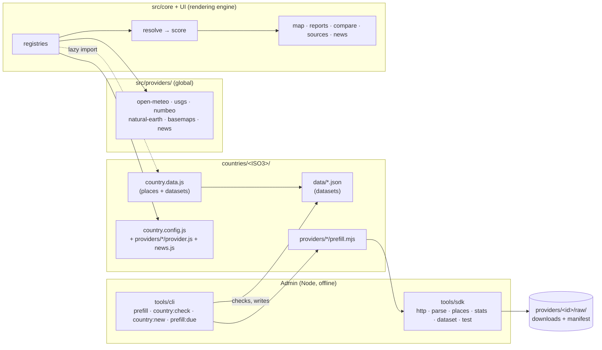

# MapStats architecture

How MapStats is structured so that each country can be integrated by its own developers, in its own folder, without touching the rendering engine.

- **Audience:** the core team, and developers who will own a country.
- **Status:** built and in use for all 16 countries. Argentina, the only curated country, runs fully on it (migration steps 0–8, [section 8](#8-migration)). Items marked *not built yet* are the agreed direction.
- **Related:** [Country integration guide](country-guide.md) · [Dataset schema](schemas/dataset.schema.json) · [Worked example country](../countries/_template/)

---

## 1. Goals

1. **Country work stays in the country folder.** A country developer works only in `countries/<ISO3>/`. They never need to edit the core to add a data source, a city list, news outlets or a yearly import.
2. **The core renders any country.** The map, scoring, reports, compare view, sources view and news are generic. They only read data that follows the contracts in [section 4](#4-contracts).
3. **Scores stay comparable across countries.** Indicators are defined once, globally, with fixed definitions and score ranges. Countries supply values for them. They do not redefine them.
4. **Every number can be traced.** Each value records its provider, the geographic level it was measured at, its period and the files it came from.
5. **The best available source wins, and the choice is explicit.** Reliability comes from what kind of source a provider is, how close its geography is to the place, and how recent its data is. The rules are the same for every country.
6. **Long-term data is prepared offline.** Yearly and other slow-moving statistics are produced by a prefill and shipped as files. The browser only calls free, keyless, CORS-enabled APIs.

## 2. Structure

The [base structure](base-structure.md) splits MapStats into **Countries** (data providers for stats and news), the **Rendering engine** and **Admin** (the yearly prefill). In the code, that becomes four areas with one-way dependencies:



Dependencies only go one way:

- `src/` never imports a specific country. It finds countries through `countries/index.js` and, in the browser, a lazy `import.meta.glob` of each `country.data.js`.
- A country imports only from `#core/define.js`, `#sdk` and its own folder. It never imports from another country.
- Browser code never imports `tools/` or a `*.mjs` prefill.

### 2.1 Folder layout

```
src/
  core/
    define.js           defineCountry / defineProvider (validation, defaults), KINDS, ACCESS, DATA_TYPES, recency()
    countries.js        country registry: COUNTRIES, countryByIso, isCurated, newsSettings
    providers.js        provider registry: providersFor(country), providerOf(indicator), families, familiesFor(country)
    resolve.js          datasets → values per place, with each provider's details (section 5)
    countryData.js      browser: lazy loader of countries/<ISO3>/country.data.js
    geoAssets.js        browser: hashed URLs of countries/<ISO3>/geo/*.json
  providers/            global providers: open-meteo/ usgs/ numbeo/ natural-earth/ basemaps/ news/
  components/           UI; report/ProviderBlocks.jsx draws any provider's yearly series
  data/metrics.js       indicator catalogue and scoring categories
  lib/                  scoring, reliability weights, live APIs and queue, provenance, exports

countries/
  index.js              one import per country (manifests only: small and pure)
  _template/            worked example country (not registered), copied from by developers
  ARG/
    country.config.js   manifest: identity, labels, geo settings, providers, news, maintainers
    country.data.js     browser entry: places + datasets (its own chunk)
    places.js           curated cities and their codes in other sources
    news.js             news language, edition, ambiguous names, regions, outlets
    providers/
      snic/             provider.js · dataset.mjs · parse.mjs · prefill.mjs · fixtures/ · provider.test.mjs
                        raw/ (downloaded bases, gitignored; manifest.json committed)
      provincial-stats/ provider.js (12 hand-entered references)
    data/               datasets (committed): snic.json · provincial-stats.json
    geo/                Natural Earth boundaries and cities: regions.json · cities.json
  BOL/ … URY/           country.config.js + geo/ (live global data only)

tools/
  sdk/                  Node toolkit for country developers (section 6)
  cli/                  prefill · country:check · country:new · prefill:due · test

netlify/                /api/news function; reads each country's news settings from the registry
tests/                  golden scoring snapshot
```

Path aliases (`imports` in `package.json`, resolved by Node, Vite and esbuild) keep imports independent of folder depth: `#core/*` → `src/core/*`, `#providers/*` → `src/providers/*`, `#sdk` → `tools/sdk/index.mjs`, `#sdk/*` → `tools/sdk/*`.

### 2.2 Why two files per country (`config` and `data`)

| File | Contents | Imported by | Size |
|---|---|---|---|
| `country.config.js` | Metadata: names, labels, bounds, provider definitions, news settings | the app, the news function, the CLI | A few KB per country |
| `country.data.js` | Places and dataset JSON | the app only, with `import()` when the country is selected | Argentina: 480 KB, its own chunk |

`countries/index.js` imports only configs, so the news function stays small (50 KB) and the main bundle carries no country data: it went from 2,100 KB to 1,667 KB when Argentina's data moved to its own chunk. Geo files are imported with `?url`, so Vite emits them with content hashes.

## 3. Contracts

The interfaces between a country and the core are JSDoc typedefs in [`src/core/define.js`](../src/core/define.js) (country files use `// @ts-check`). `defineCountry` and `defineProvider` validate at load, so a broken manifest fails the build and the tests rather than the page. Datasets have a [JSON Schema](schemas/dataset.schema.json), checked by `country:check`.

### 3.1 Indicator (core-owned)

An indicator defines **what** is measured, never who measures it ([`src/data/metrics.js`](../src/data/metrics.js)):

```js
{ id: 'homicide', label: 'Homicide rate (3-yr avg)', unit: '/100k', category: 'safety', better: 'low', domain: [0, 8], digits: 1 }
```

Rules:

- New scored indicators are added to the catalogue by pull request, reviewed by the core team.
- **The score range is only for scores.** It maps an indicator to 0–100 so different units can be averaged into category scores and the MapStats score. Everything that renders or compares an indicator uses its **real values**: map colours, legends, meters (between the country's lowest and highest value, `model.ranges`), the "best" mark in compare, charts and exports. Report and compare components never import `normalise`.
- **Standards first.** Where a recognised standard says how good or bad a value is for people, it sets the score: `src/data/standards.js` lists up to three per indicator, each with a citation and its band edges as score points (equal score steps per band). The user picks one per indicator (Weights tab), and it scores every place alike; reports, compare and the methodology name it. Today: air quality — EEA European Air Quality Index (default), US EPA AQI, or WHO 2021 PM2.5 guideline and interim targets. Each scores its own measure (European AQI, US AQI, PM2.5), all loaded from Open-Meteo as **yearly means** (last 365 days of hourly values; about 8 calls per place, cached a week).
- **Extremes are shown, not averaged away.** Each air standard also has a daily limit and the number of days a year it tolerates over it (its own rule: WHO 99th percentile ≈ 3 days, US EPA 98th percentile ≈ 7, EU 35 days). Climate extremes follow the WMO climate-extremes indices (ETCCDI): very hot days, tropical nights, frost days, very heavy rain days, longest dry spell, from the year of daily weather already loaded. A place gets a **warning** in its report, the compare view and the map popup when days over the limit exceed the standard's allowance, or when a climate count passes the thresholds in `src/data/extremes.js` (MapStats' own rules, to be reviewed). Extremes don't change scores.
- **Score ranges come from the data.** For each scored indicator, the values scoring 0 and 100 are the 2nd and 98th percentile of region-level values pooled across every country with data (`npm run anchors` → `src/data/anchors.json`, `scoreRange(id)` in `metrics.js`). Region level only, because small areas are noisier and one department would set everyone's scale. The few places beyond the anchors score 0 or 100 on that indicator. The file is frozen: it changes only when someone regenerates it, and `npm test` fails while it is out of date with the datasets, so every data PR carries its score changes explicitly. Live indicators (climate, air, earthquakes) keep the hand-set `domain` until there is offline data to anchor them on. Scores are therefore relative to the places MapStats covers, not absolute judgements, and users still weigh the categories.
- *Not built yet:* a `definition` per indicator, precise enough for two statistics offices to produce comparable numbers; a `topic` per indicator following the base structure (crime, weather, services.health…); country-declared descriptive extras.

### 3.2 Country

```js
// countries/ARG/country.config.js
import { defineCountry } from '#core/define.js'
import snic from './providers/snic/provider.js'
import provincialStats from './providers/provincial-stats/provider.js'
import news from './news.js'

export default defineCountry({
  iso3: 'ARG', iso2: 'AR', name: 'Argentina',
  regionLabel: 'Province', subregionLabel: 'Department',
  geo: { simplify: '18%' },                         // Natural Earth build settings (defaults: 8 %, cities ≥ 100k, 120 max)
  providers: ['numbeo', snic, provincialStats],     // opt-in global ids (numbeo: links only) + its own definitions
  news,
  maintainers: ['@codealchemist'],
})
```

Global live providers (Open-Meteo, USGS, Natural Earth, basemaps, news) serve every country without being listed. The country's own providers are namespaced `ARG/<id>`. A country is **curated** when it has providers of its own (opting into a link-only global provider does not count).

### 3.3 Provider

A provider is one data source. **Global** providers live in `src/providers/<id>/`; **country** providers in `countries/<ISO3>/providers/<id>/`. One `provider.js` may export several related providers (Open-Meteo's APIs, Argentina's 12 hand-entered references).

```js
// countries/ARG/providers/snic/provider.js (abridged)
defineProvider({
  id: 'snic', short: 'SNIC', name: 'SNIC – Ministerio de Seguridad', url: 'https://…',
  covers: 'Official crime statistics by province and department…',
  kind: 'register',                          // base reliability (table below)
  family: { id: 'snic', label: 'SNIC · official crime statistics', short: 'SNIC' },   // source-selector group
  levels: ['region', 'subregion', 'city'],   // where its values are measured
  provides: ['homicide', 'propertyCrime', 'roadDeaths'],
  access: 'import', cadence: 'Annual (2000–latest year)', refresh: 'year', scope: 'Argentina · province & department',
  types: ['crime'],                          // sources-view section
  report: { category: 'safety', label: 'Official SNIC statistics', trends: { … }, latestTable: { … }, footnote: '…' },
  provenance: ({ entity, detail, meta }) => ({ level, area, period, status, rows, note }),
  weightFactors: ({ type, level, detail }) => [['department, not city boundary', 0.9], …],
})
```

| Field | Used for |
|---|---|
| `provides` | Which provider stands behind each indicator (`providerOf`); every indicator has exactly one today |
| `kind`, `family`, `levels` | Reliability weights and the single-source selector; required for scored data |
| `access`, `cadence`, `scope`, `types`, `usedFor` | The sources view |
| `refresh` | `prefill:due` (year · quarter · month) |
| `links(entity)` | The source's own pages about a place (e.g. Numbeo, links only) |
| `optIn` | Global providers only: serves just the countries that list it |
| `report` | How the report and compare views present its details: category, heading label, trend charts and latest-rates table |
| `provenance(ctx)` | Its group in "values by source" |
| `weightFactors(ctx)` | Extra reliability factors, from its details for the place |

**Base reliability by kind** (`KINDS` in `define.js`):

| `kind` | Weight | Meaning | Today |
|---|---|---|---|
| `register` | 1.0 | Official count of recorded cases | SNIC |
| `measurement` | 1.0 | Instrument or reanalysis | Open-Meteo, USGS |
| `official-survey` | 0.8 | Statistics office survey with published methodology | the template's example |
| `crowd-survey` | 0.5 | Perception survey, self-selected respondents | none (Numbeo is links only, section 9) |
| `estimate` | 0.3 | Modelled or derived | |
| `manual` | 0.3 | Hand-entered from a publication | Argentina's provincial statistics |

**Generic factors**, applied by the core to every family: a family that only publishes region-wide figures counts ×0.5 for a city; any other family's value borrowed from the region counts ×0.5. Provider-specific factors (SNIC: department ×0.9, recency) come from `weightFactors`.

### 3.4 Places and levels

| Level | What it is | Id | Comes from |
|---|---|---|---|
| `national` | The country | `ISO3` | config |
| `region` | First-level division | ISO 3166-2, e.g. `AR-B` | `geo/regions.json` (Natural Earth) |
| `subregion` | Second level (partido, municipality, county) | the national statistical code, e.g. `06441` | provider data; no polygons needed |
| `city` | Point place | `ISO3-slug`, e.g. `ARG-la-plata` | `places.js`, else the Natural Earth city list |

A curated city carries `codes` linking it to other sources' identifiers. `codes.subregion` is read by the core, and the other codes by their provider (`codes.numbeo`: the city's Numbeo page, for links):

```js
{ id: 'ARG-la-plata', name: 'La Plata', region: 'AR-B', lat: -34.9214, lon: -57.9545, pop: 772618, codes: { subregion: '06441', numbeo: 'La-Plata' } }
```

City ids are permanent: saved comparisons and links use them.

### 3.5 Dataset (output of a prefill, input of the app)

One JSON file per provider and country in `countries/<ISO3>/data/<id>.json` ([schema](schemas/dataset.schema.json), [example](../countries/_template/data/example-stats.json)).

```jsonc
{
  "schema": 1,
  "provider": "ARG/snic",                // or "providers": { indicator: provider } for a compilation
  "country": "ARG",
  "generatedAt": "2026-10-11T00:00:00Z",
  "period": { "latest": 2025, "aggregation": "mean of 2023–2025 (per 100,000)" },
  "origin": { "files": [{ "name": "snic_provincias_2000_2025.xlsx", "sha256": "b25d…", "retrievedAt": "2026-10-05" }], "notes": "…" },
  "values": {                            // level → place id → indicator → number | null, in the indicator's unit
    "national":  { "ARG": { "homicide": 3.98 } },
    "region":    { "AR-B": { "homicide": 4.63, "propertyCrime": 1146.95 } },
    "subregion": { "06441": { "homicide": 3.11 } },
    "city":      { "ARG-buenos-aires": { "homicide": 2.69 } }
  },
  "names":   { "subregion": { "06441": "La Plata" } },                    // places the geo files don't name
  "series":  { "years": [2016, …, 2025], "region": { "AR-B": { "homicide": [6.83, …] } } },   // trend charts
  "details": { "region": { "AR-B": { "latestYear": 2025, "latest": { … }, "counts": { … } } } } // provider-specific
}
```

Rules:

- **Missing stays missing.** Use `null` or leave the indicator out. Never fill a value from a neighbouring area or an estimate inside a dataset: the core decides what to borrow and labels it.
- Values use the **indicator's unit**. Conversions happen in the prefill.
- Every id must exist: region ids in `geo/regions.json`, city ids in the place list, indicators in the catalogue, providers in the country's config. `prefill` and `country:check` enforce this.

### 3.6 Live providers

The global live providers (Open-Meteo, USGS) are fetched in the browser through the shared queue and cache (`src/lib/meteoQueue.js`, `src/lib/live.js`), which keep within Open-Meteo's free budget. A source that needs a key, a proxy or scraping is not a live provider: it becomes a prefill dataset, or (with core-team review) a Netlify function like `/api/news`. *Not built yet:* a plug-in interface for live providers (`fetchBatch`, `fetchDetail`); today adding one means editing `src/lib/live.js`.

### 3.7 Report and compare

There are no per-country components. Generic UI draws whatever the country's providers describe in `report`:

| Provider data for a place | Generated UI |
|---|---|
| `values` | Indicator rows, meters, scores, compare rows, exports |
| `details.series` + `report.trends` | "Official statistics" block: trend charts (place, its region, the country) and the latest-rates table; compare line charts and side-by-side rows |
| a `report.trends` chart with `lastYear` + `details.latest` | A compare row and focus bars with the latest year's published value (SNIC: homicides, robberies and thefts) |
| `provenance()` | Its group in "values by source" (report, CSV, PDF) |
| any details | A source tag on the place in search results |

### 3.8 News

`countries/<ISO3>/news.js` (or an inline `news` object) is pure data, read by the app and the `/api/news` function:

```js
export default {
  lang: 'es', countryName: 'Argentina', edition: { hl: 'es-419', gl: 'AR' },   // Google News edition
  ambiguousNames: ['merlo', 'junin', …],     // searched together with their province
  regionPrefixes: ['provincia de '],
  regions: [ … ],                            // for coverage reports
  outlets: { verified: [{ domain, feed, regions, cities }], candidates: [{ domain, regions, cities, note }] },
}
```

The pipeline (`netlify/news/`) is generic. `npm run news:probe -- --country=<ISO3>` checks outlets and prints the line to move a candidate into `verified`. News is never used in scores.

## 4. Runtime data flow

```
select country
  └─ config (sync) + import('country.data.js') (lazy) + geo (fetch)
       └─ places = curated places ?? Natural Earth cities
            └─ live layers fill points progressively (queue + cache)
                 └─ resolvePlaces(datasets, places)              src/core/resolve.js
                      └─ buildEntities: + live → score(values, weights, mode)   src/lib/scoring.js
                           └─ map · ranking · reports · compare · exports
```

`resolvePlaces` is the one place that decides how a published value reaches a place. It works on levels, not on providers:

| Rule | Example |
|---|---|
| A city takes its own city-level values, then its subregion's (`codes.subregion`). Both count as its own, even when published as `null`. | La Plata gets its SNIC department's rates |
| A region takes its region-level values. Indicators only published per city are the population-weighted mean of the region's cities that have them. | none in Argentina today |
| A city without its own value borrows its region's, marked `inherited`. Scores and labels treat it as the region's figure. | the provincial statistics, for every Argentine city |
| Population is never borrowed. | |

Each place also gets `details[providerId] = { level, code, name, series, …provider fields }`, which the report, compare, search, provenance and weight factors read.

## 5. The country developer toolkit (`tools/sdk`, `#sdk`)

Node only, used by prefills and tests.

| Module | Provides |
|---|---|
| `http` | `rawStore(iso3, id)`: `fetchOnce(url)` downloads each file once into the provider's `raw/` folder, honours robots.txt, identifies MapStats, spaces requests (5 s), stops at the first 403/429, and records URL, date and SHA-256 in `manifest.json`. `add(name, { note })` registers a file downloaded by hand. `read`, `list`. |
| `parse` | `parseCsv` (quoted fields, delimiter detection, BOM), `readXlsx` (streamed, for 100 MB+ workbooks), `loadHtml` (cheerio), `num` (decimal commas, blanks and dashes → `null`) |
| `places` | `fold`, `matcher(entries, { strip })` that reports unmatched names instead of guessing, `featureAt(lat, lon, featureCollection)` |
| `stats` | `round`, `per100k`, `share`, `meanOfLast` |
| `dataset` | `checkDataset` (schema, ids, providers, domains, coverage), `writeDataset` |
| `test` | `check`, `section`, `fixture`, `done` |

**CLI** (`npm run …`):

| Command | Does |
|---|---|
| `country:new -- <ISO3> --iso2 XX --name "…" --region-label …` | Starts and registers a country folder (Tier 0 once geo is built) |
| `geo -- <ISO3>` | Natural Earth → `countries/<ISO3>/geo/`, with the config's `geo` settings (`NE_DIR` required) |
| `prefill -- <ISO3> [--provider id] [--out file]` | Runs `providers/<id>/prefill.mjs`, checks the dataset, writes `data/<id>.json` only without errors |
| `country:check -- <ISO3>` | Config, geo, places, datasets (coverage, domain warnings), provider tests, the tier reached |
| `prefill:due` | Datasets older than their providers' `refresh` |
| `anchors` | Recompute the score anchors from every country's datasets (`src/data/anchors.json`) |
| `test` | Every offline suite: news, live, golden, anchors up to date, every `provider.test.mjs` (template included) |

Argentina's `snic:import` is `prefill -- ARG --provider snic`.

## 6. Admin: the prefill process

Long-term data is prepared offline, reviewed as a pull request and shipped as files. Visitors never fetch it.

```
acquire  → providers/<id>/raw/ + manifest.json (url, date, sha256)      once, politely (rawStore)
parse    → rows                                                         pure, fixture-tested (parse.mjs)
map      → place ids, indicator ids, indicator units                    unmatched names reported, never guessed
check    → schema · ids · providers · domains · coverage                the run fails on errors
write    → countries/<ISO3>/data/<id>.json                              committed, reviewed in a PR
```

**Calendar.** `.github/workflows/data-refresh.yml` runs `prefill:due` monthly and opens an issue listing stale datasets, naming the countries' maintainers. There is no admin web UI: the app stays static, and the pull request is the review step.

**Raw files** stay local (licences, size), in the provider that reads them: `countries/<ISO3>/providers/<id>/raw/`. Its `manifest.json` is committed, so anyone can fetch the same files and verify the hashes.

## 7. Guarantees and checks

| Check | Runs in | Guards |
|---|---|---|
| `tests/anchors.mjs` | `npm test`, CI | The committed score anchors match the datasets |
| `tests/golden.mjs` | `npm test`, CI | Scores, categories, per-source scores, weights and reasons, ranks and values for Argentina and Bolivia, every source mode, against a snapshot. Every migration step kept it identical; the two intended score changes (Numbeo, anchors) updated it with their impact in the commit. |
| `provider.test.mjs` per provider | `npm test`, `country:check` | Each source's parsing and mapping rules, on fixtures |
| `defineCountry` / `defineProvider` | load time | Manifests and provider definitions |
| `country:check` | by developers and reviewers | A country folder as a whole |
| CI (`.github/workflows/ci.yml`) | every PR | lint, `npm test`, build |

## 8. Migration

| # | Step | Result |
|---|---|---|
| 0 | Golden test, `npm test`, CI | Done |
| 1 | Country registry: per-country folders, manifests, geo | Done |
| 2 | Provider registry: sources as provider definitions; reliability from kinds | Done |
| 3 | Datasets + generic resolver; Argentina loads lazily | Done (identical scores; values by source identical for all 79 places) |
| 4 | Generic report, compare, search and provenance | Done (wording changes listed in the commit) |
| 5 | News settings and outlets per country | Done (queries and outlets identical for 116 places) |
| 6 | SDK, CLI, Argentina's importers as provider prefills, template | Done (SNIC prefill reproduces its dataset exactly) |
| 7 | Numbeo: links only (its terms forbid collecting or republishing its data without consent) | Done (scores change: 2.9 points on average for affected places) |
| 8 | Score anchors from the data (2nd–98th percentile of region values) | Done (scores change: 2.6–3.2 points on average; Argentina's spread widens) |
| 9 | **Pilot:** a developer new to the codebase curates a second country with only the guide; anchors regenerated with two countries (scores change, announced); guide fixed from their feedback | Next |

## 9. Open decisions

1. **Standards for the other live indicators.** Air quality scores with standards (EEA, US EPA, WHO). Next, by the same mechanism: thermal comfort (UTCI, US NWS Heat Index + Wind Chill, Humidex; replaces our own comfort model and needs humidity and wind in the climate batch), UV (WHO UV index, making UV scored) and seismic hazard (GEM hazard map, national building codes; needs an offline sampling of the GEM map). Each changes scores in every country.
2. **Numbeo.** MapStats shows no Numbeo data: its terms (as reported in October 2026, not verified against the live pages) forbid automated collection without written permission and republishing on public sites without consent, and allow storing API data only while subscribed (€49–299 a month). Showing Numbeo values again needs Numbeo's written consent for a free public site (contact@numbeo.com); the academic licence form is marked temporarily unavailable.
3. **JSDoc or TypeScript.** JSDoc with `// @ts-check` is in place; revisit TypeScript once the contracts settle.
4. **Global harmonised sources**, to give every country a baseline before it has local maintainers. Candidates, each to be evaluated against the [source checklist](country-guide.md#3-choosing-sources): Global Data Lab (subnational HDI, education, health), World Bank / UNODC (national homicide), Eurostat NUTS-2 for the European countries, Ookla Open Data (broadband), WorldPop (population).
5. **Ownership.** A `CODEOWNERS` file: `/countries/<ISO3>/` to each country's maintainers, `src/` and `tools/` to the core team.
